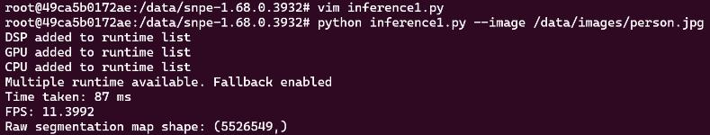
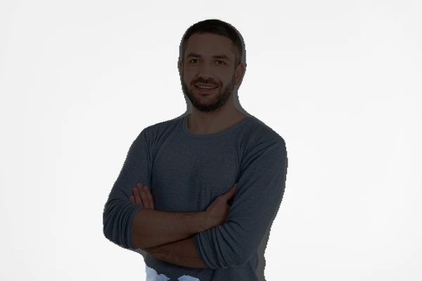
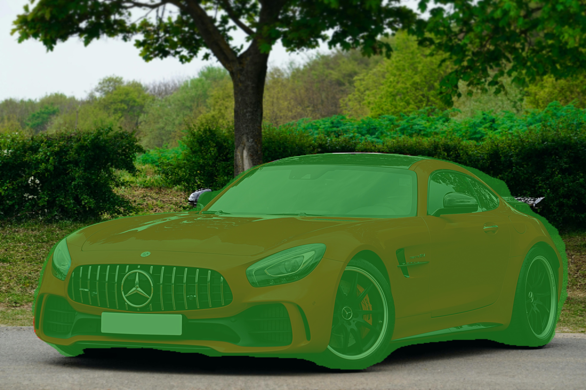
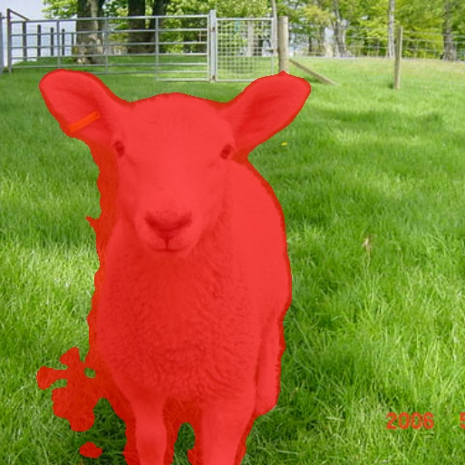

# Dockerized-SNPE-Environment-with-DSP-runtime-Qualcomm-Edge

This project provides a Docker container setup with DSP runtime support for the Qualcomm RB5 platform. The Dockerfile is designed to configure the container environment, install necessary dependencies, and copy essential libraries and files required to run SNPE (Snapdragon Neural Processing Engine) models on the DSP. As part of the implementation the AI-Hub's Deeplabv3+ MobileNet model, converted to the DLC format, was tested for image segmentation tasks. The model achieved an inference rate of 11 FPS on the DSP runtime of the Qualcomm RB5 device.

This implementation uses SNPE SDK version 1.68.0.3932, but users can download and use any compatible version from Qualcomm's official resources.

## Prerequisites

1. **Docker** installed on your machine.
2. Qualcomm RB5 device with proper permissions to access DSP and necessary files.
3. Python 3.6
4. Download the SNPE SDK into snpe folder (snpe-1.68.0.3932) and update the same version inside Dockerfile.
5. Qualcomm AI Hub Model: https://aihub.qualcomm.com/models/deeplabv3_plus_mobilenet

## Dockerfile Details 

1. **Base Image**: Starts from `python:3.6-slim-buster`.
2. **Installs**: 
- `vim` and `libatomic1` as utilities and dependencies.
- Python packages: `decorator`, `scipy`, `psutil`, `attrs`, `tqdm`, and `typing-extensions`.
3. **Copy Files**: Copies required libraries and files to specified directories in the container to support DSP runtime.
4. **Environment Variables**:
- `PATH`: Adds SNPE directory to the executable path.
- `LD_LIBRARY_PATH`: Adds SNPE directory to the library path.
- `ADSP_LIBRARY_PATH`: Sets up paths for the DSP libraries.

## Instructions

### 1. clone the repository into RB5
```bash
$ cd /data
$ git clone <source repository>
```
### 2. Build the Docker Image

To build the Docker image, open a terminal in the directory containing the Dockerfile and run:

```bash
$ cd Dockerized-SNPE-Environment-with-DSP-runtime-Qualcomm-Edge/
$ docker build -t snpe . 
```
### 3. Run the Container

To start an interactive shell in the container, use:

```bash
$ docker run -it --privileged  -v /data/Dockerized-SNPE-Environment-with-DSP-runtime-Qualcomm-Edge/images:/data/images -v /data/Dockerized-SNPE-Environment-with-DSP-runtime-Qualcomm-Edge/model:/data/model -v /dsp:/dsp -v /data/Dockerized-SNPE-Environment-with-DSP-runtime-Qualcomm-Edge/utilities:/usr/lib/rfsa/adsp/ snpe /bin/bash
```
Note: --privileged is required to access hardware resources on the RB5.

### 4. (optional) check snpe-throughput-net-run for Deeplabv3+ MobileNet model inside container

```bash
$ cd /data/snpe-1.68.0.3932/ 
$ snpe-throughput-net-run --container /data/model/deeplabv3_plus_mobilenet_quantized.dlc --duration 10 --use_dsp --perf_profile default
```

### 5. Run the python inference inside container

```bash
$ cd /data/snpe-1.68.0.3932/
$ python inference.py --image /data/images/person.jpg  
```


### 6. Copy the output image from the Docker container to your local machine

In a new RB5 terminal, run the following command to copy the output image from the Docker container to the RB5 device, and then transfer it to your laptop to interpret the results. 

```bash
$ docker cp <container_id_or_name>:/path/in/container/output.jpg /path/on/rb5/output.jpg
$ scp root@<RB5_IP_ADDRESS>:<path_to_output_image> <local_directory>
``` 
Example:

```bash 
$ docker cp 49ca5b0172ae:/data/snpe-1.68.0.3932/Segmentation_Output_DSP.jpg /data/Dockerized-SNPE-Environment-with-DSP-runtime-Qualcomm-Edge/output_images/Segmentation_Output_DSP.jpg

$ scp root@10.155.1.194:/data/Dockerized-SNPE-Environment-with-DSP-runtime-Qualcomm-Edge/output_images/Segmentation_Output_DSP.jpg /mnt/c/Users/SMEDIDA/Downloads/
```
## Inference Results






